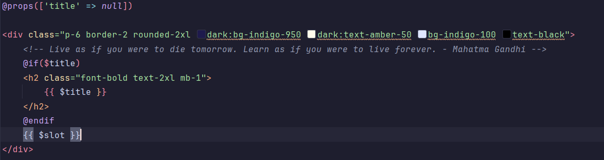
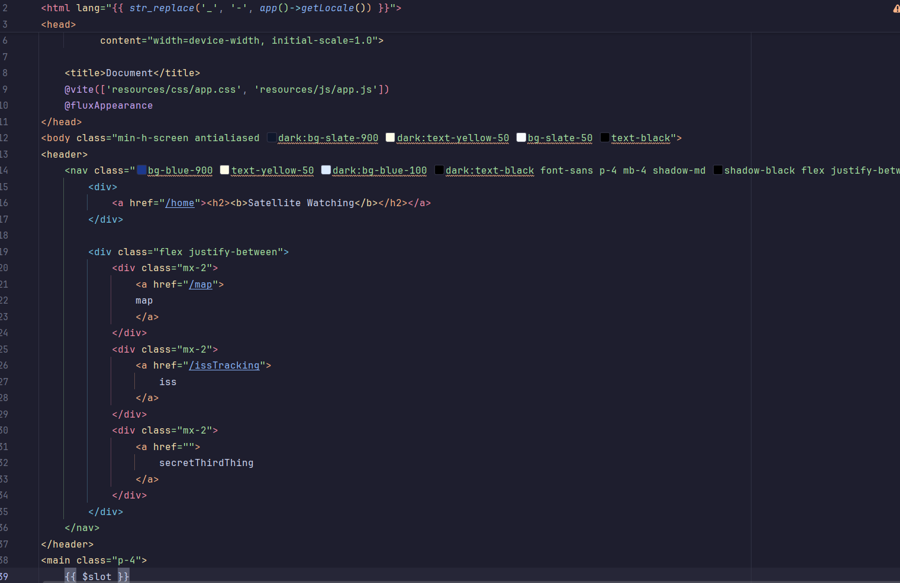
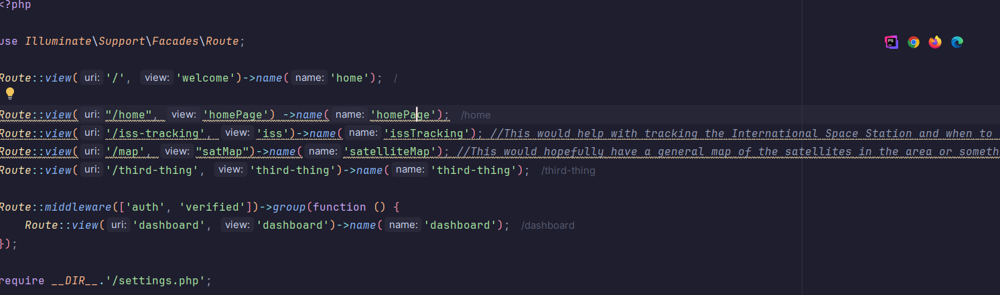
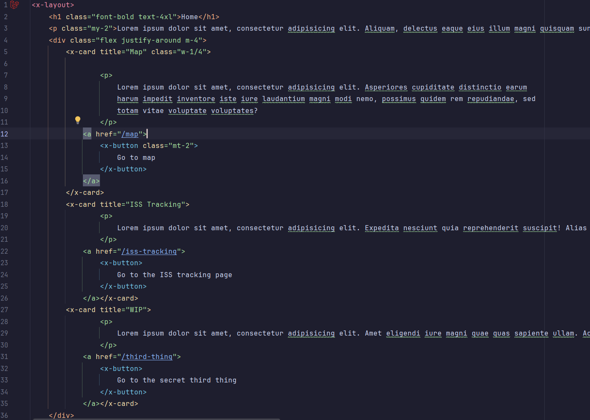

1. Progress
   - I have implemented all the major architecture and elements as outlined in the milestone requirements. I have routed the different pages that I, at least for now, have outlinted the functionalities for, including one mock page reserved for purposes I am still doing research into.
   - I have created reusable elements, including a reusable layout with a header and functional navigation to the homepage and some basic Tailwind styling and have applied this template to all the created pages. I have also created a card ana button component, which I used in the main page for functional navigation to other pages.
2. Techincal Decisions
    - For now, I have only used the button and card components in my main page, which aims to showcase the different functionalities of this web application and navigate to them. I have decided to make the button component fit the space theme of the site. 
    - The card component I have created is a very broad and universal card component. I aim to reuse this component for very general purposes, and modify, or perhaps create more specialised versions of this component for more specific tasks.
    - The routing was created logically based on the main functionalities of this web application, that being the general map of nearby satellites and specific tracking of the International Space Station. The uris that route to them are simple names that represent their functionalities.
3. Challenges
    - I have been struggling with personal and health issues which have greatly contributed to procrostination on this milestone, resulting in me being unable to clone the repository required to start this project. I have tackled this problem by temporarily creating an entirely separate version of this project, that I can use to copy all my already completed work once I have access to the dedicated repository for this project. Further on, I will take to heart the lesson of not leaving work for later and instead tackling it early. More importantly, I will remember to check my email.
    - I encountered slight issues with the variables my card component. I solved them by once again going through the provided course material and studying it, then using it in this work.
4. Next Steps
   - Once I am able to, I will first and foremost work on making sure this work is in line with the requirements for this project, that is, that it is placed on the actual repository provided by the organisation.
   - The pages are mostly representations of what they can provide in the future. I will work on ensuring content is present in them and improving their styling.
   - The header, while functional, is sitll fairly basic and requires a lot of work. I will work to make sure it looks and functions properly.
   - The components are functional and styled, but they still require more work to look comparable to modern web applications.
5. Evidence
   -  This is the card component that includes multiple variables and styling.
   -  A functional reusable layout for different pages.
   -  Working routing table with comments.
   -  Functional home page for the web application that includes the reusable layout.
